# Q-Optima ⚛️

[](https://colab.research.google.com/github/shaswatprof2000-git-hub/q-optima/blob/main/notebooks/q_optima_colab.ipynb)
[](https://github.com/shaswatprof2000-git-hub/q-optima/actions/workflows/tests.yml)


**Hybrid quantum–classical optimisation and quantum-AI on real data, with every answer checked against a proven optimum.**

Q-Optima turns real decisions (delivery routes in Odisha, NSE stock portfolios, buyer–plot matching, splitting real social networks) into qubits. It builds the actual quantum circuits, runs them on an exact simulator, under realistic hardware noise or on IBM quantum computers, and compares every result with classical methods. It also includes quantum machine learning on real medical data, and AI that learns quantum-circuit settings.

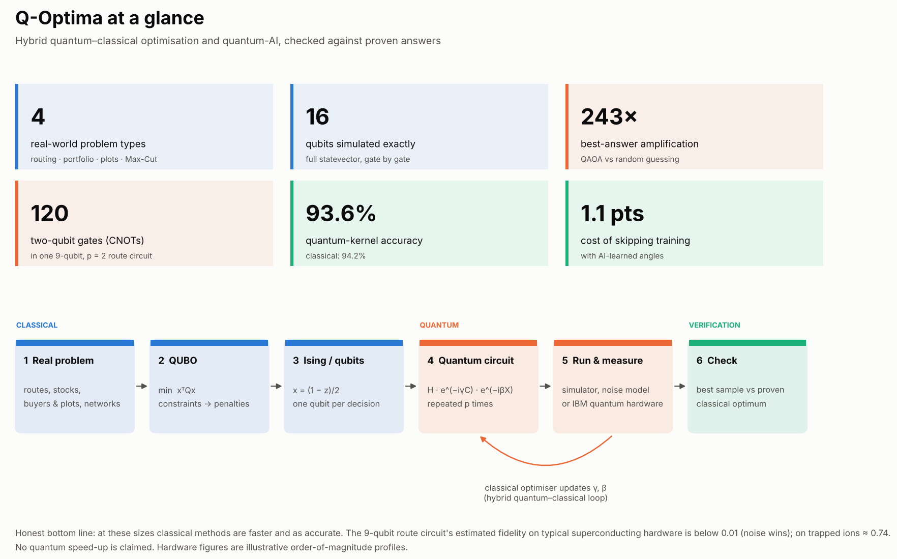

> **Honesty first:** every problem here is small enough for classical computers to solve exactly. That's what lets us *check* the quantum results. **No quantum speed-up is claimed**, and the charts show where classical methods win.

## What's inside

| Layer | What it does | Code |
|---|---|---|
| **Quantum algorithm** | QAOA with standard, CVaR, warm-start and layer-wise (INTERP) training; exact statevector simulation up to 22 qubits | `qoptima/solvers/qaoa.py` |
| **Quantum computer** | Gate-level circuits (H, RX, RY, RZ, RZZ → CNOT), depth and CNOT counts, OpenQASM 2.0 export, Bloch vectors, entanglement entropy | `qoptima/quantum/` |
| **Quantum hardware** | Noise model (gate and readout errors, decoherence), SWAP overhead from qubit connectivity, superconducting vs trapped-ion profiles, optional IBM Quantum runs | `qoptima/quantum/hardware.py`, `solvers/qiskit_backend.py` |
| **Problems** | Routing (TSP), portfolio (Markowitz), real-estate buyer–plot matching, Max-Cut | `qoptima/problems/` |
| **Quantum-AI** | Quantum-kernel classifier (ZZ feature map + SVM) vs classical models; AI-learned QAOA angles that skip training | `qoptima/qml/` |
| **Real data** | Odisha town coordinates and live OSRM road distances, live NSE prices, Florentine families and karate-club networks, Breast Cancer Wisconsin and Wine datasets | `qoptima/datasets.py` |
| **Graphics** | Flowcharts, circuit diagrams, Bloch spheres, energy landscapes, device comparisons, infographic | `qoptima/viz.py` |
| **Theory** | Every formula, with diagrams and references | [`docs/THEORY.md`](docs/THEORY.md) |
| **Interactive** | Colab notebook with sliders: rotate a qubit, explore QAOA angles, design your own hardware, tune the quantum kernel | [`notebooks/`](notebooks/q_optima_colab.ipynb) |

## Run it

**1. In your browser (no installation):** click **Open in Colab** above, then **Runtime → Run all** (about 2–4 minutes).

**2. On your computer:**

```bash
git clone https://github.com/shaswatprof2000-git-hub/q-optima && cd q-optima
python3 -m venv .venv && source .venv/bin/activate      # Windows: .venv\Scripts\activate
pip install -e ".[dev]"
pytest -q                                               # 31 tests
python -m qoptima figures                               # all charts -> docs/images/
```

**3. With Claude Code** (VS Code or terminal): open the folder and type `/run-demo`. Other commands: `/benchmark`, `/figures`, `/add-problem <idea>`, `/explain <topic>`, `/ibm-hardware`, `/publish`. Claude reads the project rules from `CLAUDE.md`.

### Commands

| Command | What you get |
|---|---|
| `python -m qoptima route --places examples/places.csv` | best visiting order: classical vs annealing vs QAOA |
| `python -m qoptima odisha --n 8` | 8 Odisha towns on real road distances (49-qubit QUBO) |
| `python -m qoptima maxcut [--graph karate]` | split a real social network |
| `python -m qoptima portfolio --prices file.csv --k 3` | pick k stocks (CSV of daily closes) |
| `python -m qoptima plots --buyers b.csv --plots p.csv` | match buyers to plots |
| `python -m qoptima circuit --qasm route.qasm` | gate counts, depth, hardware estimates, OpenQASM file |
| `python -m qoptima qml --qubits 6` | quantum-kernel classifier vs classical models |
| `python -m qoptima benchmark` | full table → `results/benchmark.md` |
| `python -m qoptima figures` | every figure + infographic → `docs/images/` |

Add `--ibm` to `route`, `portfolio`, `plots` or `maxcut` to sample the trained circuit on IBM Quantum hardware (`pip install -e ".[qiskit]"`).

## How it works

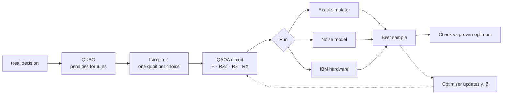

The maths behind every step, from qubits to the Ising mapping, QAOA, noise and quantum kernels, is in **[docs/THEORY.md](docs/THEORY.md)**.

## Gallery

| | |
|---|---|
| 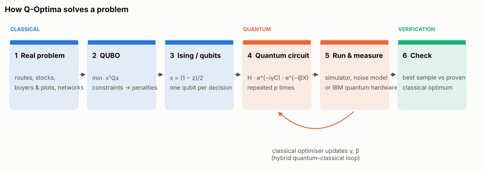 **The pipeline**: classical problem → quantum circuit → checked answer | 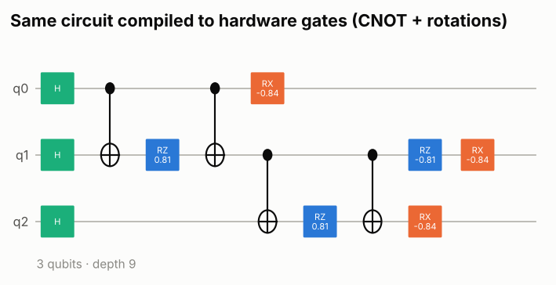 **A QAOA circuit** compiled to hardware gates (CNOT + rotations) |
| 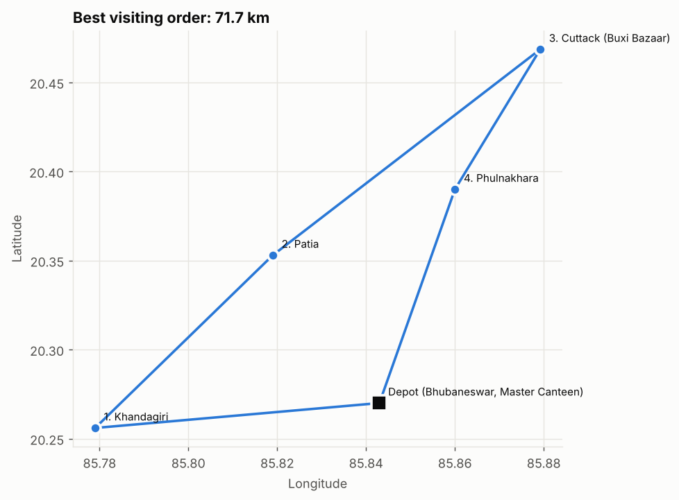 **Best route** through Bhubaneswar–Cuttack stops (16 qubits) | 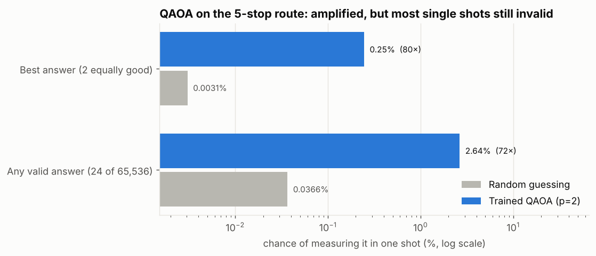 **Amplification**: QAOA makes the best route ~80× more likely than guessing, but most shots are still invalid |
| 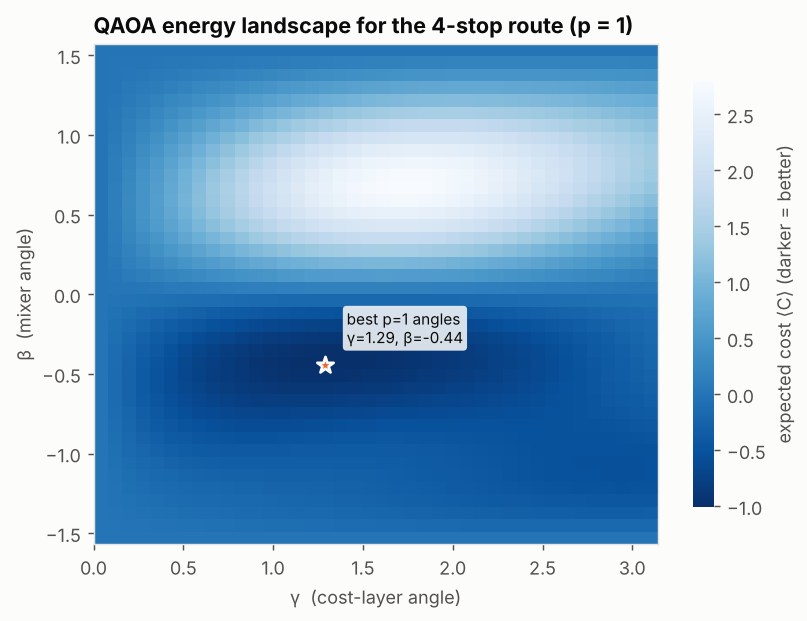 **Energy landscape** the optimiser searches (p = 1) | 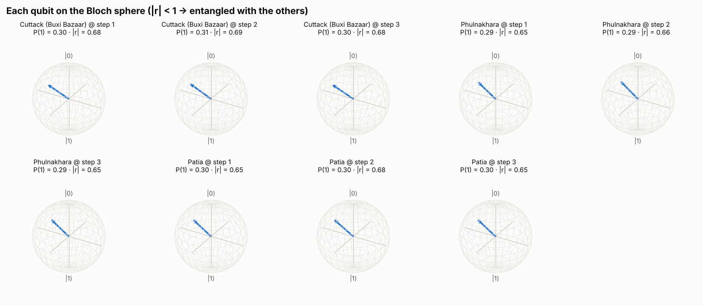 **Qubits on the Bloch sphere**: inside the sphere means entangled |
| 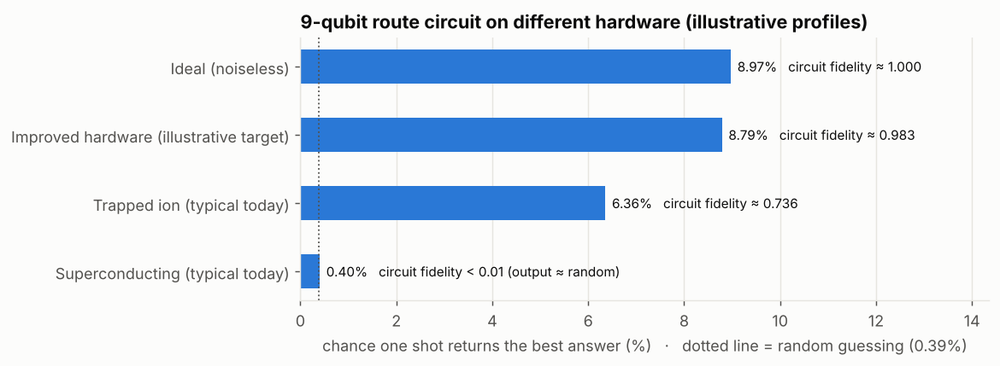 **Same circuit, different hardware**: noise and SWAPs on sparse chips erase the advantage | 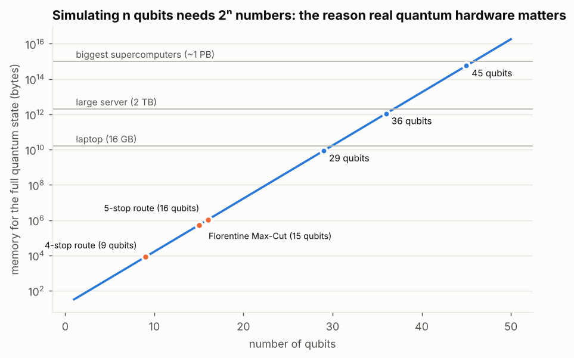 **Why hardware matters**: simulating n qubits needs 16·2ⁿ bytes |
| 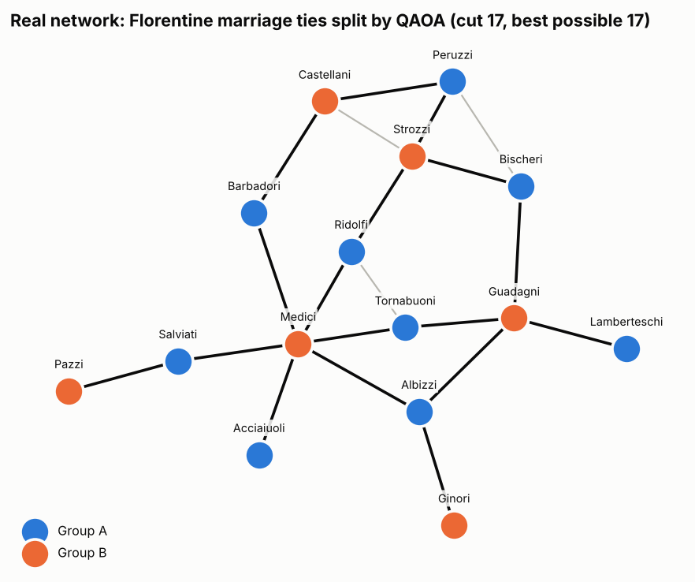 **Real network**: Florentine marriage ties split optimally (15 qubits) | 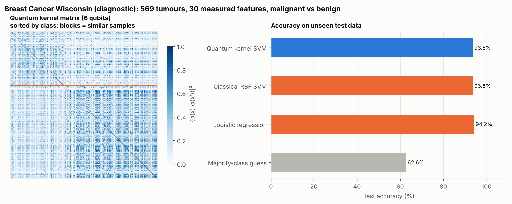 **Quantum-AI** on 569 real tumours: the quantum kernel matches classical models but doesn't beat them |
| 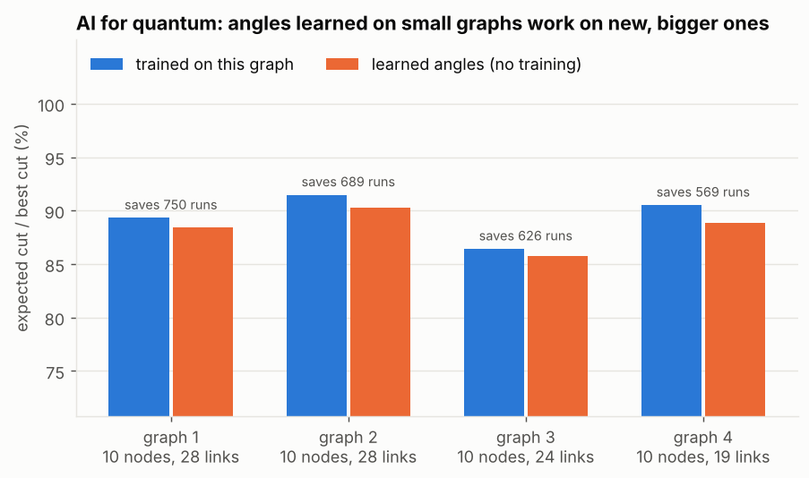 **AI for quantum**: learned angles come within ~1 point of full training, with zero training runs | 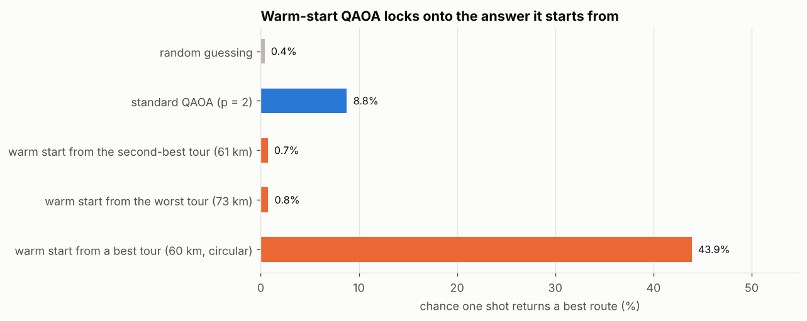 **Warm starts** lock onto their starting answer, so they only help if it's already good |

## Results in brief

From `results/benchmark.md` and `docs/images/stats.json` (fixed seeds, reproducible):

- **Correctness:** on 7 instances (8–16 qubits), noiseless QAOA, noisy QAOA (on the smaller instances) and simulated annealing all found the proven optimum.
- **Amplification:** QAOA (p = 2) made an optimal answer 80× (5-stop route) and 243× (Florentine Max-Cut) more likely than random guessing.
- **Hardware reality:** a 9-qubit, p = 2 route circuit needs 120 CNOTs (depth 77). With the illustrative profiles, estimated fidelity is about 0.74 on trapped ions and below 0.01 on a sparse superconducting layout. That second figure comes from a deliberately pessimistic SWAP model, but even so the output would be close to random.
- **Quantum-AI:** quantum kernel 93.6% test accuracy vs classical RBF-SVM 93.6% and logistic regression 94.2% (Breast Cancer Wisconsin, 6 qubits).
- **Learned angles:** about 1.1 percentage points below fully trained QAOA on unseen 10-node graphs, saving around 600–750 circuit runs each.
- **Speed:** classical exact methods solve every instance in milliseconds. That's expected at these sizes.

## Real data used

| Data | Source | Used for |
|---|---|---|
| 15 Odisha towns (approx. coordinates) | bundled | routes, `odisha` command |
| Driving distances | OSRM public server (live), falls back to straight-line × 1.3 | routes in Colab |
| NSE daily closes (Reliance, TCS, HDFC Bank, Infosys, …) | Yahoo Finance via `yfinance` (live), falls back to labelled synthetic data | portfolio |
| Florentine families marriage network (Padgett & Ansell, 1993) | networkx | Max-Cut |
| Zachary's karate club (1977) | networkx | Max-Cut |
| Breast Cancer Wisconsin (569 patients), Wine (178 samples) | scikit-learn (UCI) | quantum-kernel classifier |
| Buyers and plots | illustrative sample | real-estate matching |

## Project layout

```
qoptima/
  qubo.py            QUBO model, penalties, Ising conversion
  solvers/           exact, annealing, QAOA (+ CVaR, warm start, INTERP, noise), Qiskit/IBM adapter
  quantum/           gate-level circuits, OpenQASM, hardware profiles, Bloch & entanglement
  problems/          routing, portfolio, plot_matching, maxcut
  qml/               quantum kernels, learned QAOA angles
  datasets.py        real data loaders (offline + live with fallback)
  viz.py             all graphics      showcase.py   experiments behind the figures
  benchmark.py       cli.py
docs/THEORY.md       formulas, diagrams, references      docs/images/   generated figures
notebooks/           interactive Colab notebook (+ build_notebook.py that generates it)
.claude/commands/    Claude Code slash commands         CLAUDE.md      project rules for Claude Code
tests/               31 tests (run by GitHub Actions on pushes to main and on pull requests)
```

## Roadmap

- [ ] Real IBM Quantum hardware results table (`/ibm-hardware`)
- [ ] Site-visit scheduling with time windows (Raj Sundari sales team)
- [ ] Portfolio plug-in reading holdings from Portfolio X-Ray
- [ ] Variational quantum classifier alongside the quantum kernel
- [ ] Decomposition into sub-QUBOs for larger instances

## Notes

- Hardware profiles are **illustrative orders of magnitude**, not any specific machine.
- Buyer/plot data and the fallback prices are illustrative. The portfolio tool is educational, not investment advice.
- The quantum-kernel classifier is a learning tool, not a medical diagnostic.
- The IBM hardware path is written but has not yet been run end to end.

MIT licence · Shaswat Mohanty
