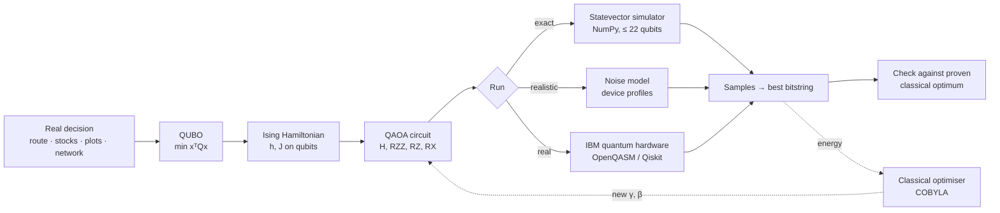
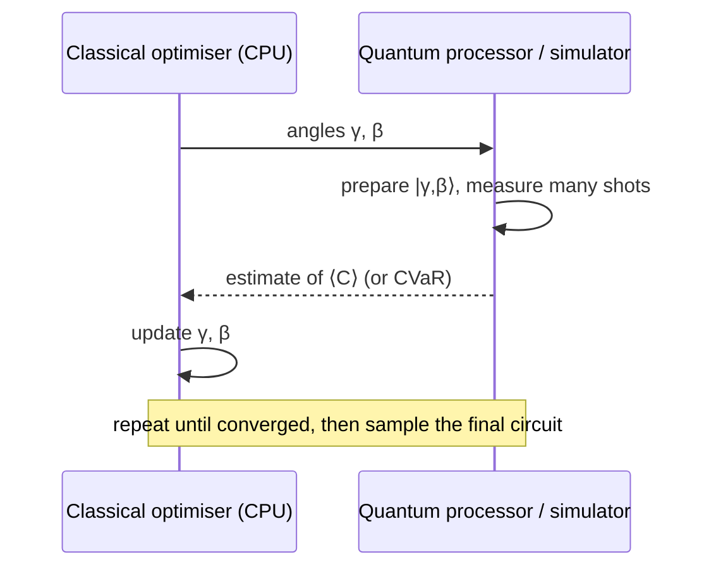
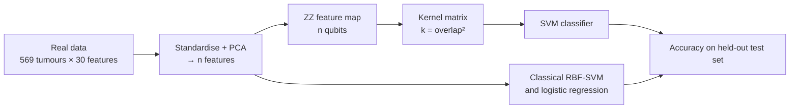

# The quantum theory behind Q-Optima

This page explains every formula the code uses, in the order the data flows. The figures come from `python -m qoptima figures`, and each section names the file that implements it.

---

## 1. Qubits

A qubit is a unit vector in a 2-dimensional complex space:

$$|\psi\rangle = \alpha|0\rangle + \beta|1\rangle,\qquad |\alpha|^2 + |\beta|^2 = 1 .$$

Measuring gives 0 with probability $|\alpha|^2$ and 1 with probability $|\beta|^2$ (the Born rule). Up to an unobservable global phase, any single-qubit state is a point on the **Bloch sphere**:

$$|\psi\rangle = \cos\tfrac{\theta}{2}|0\rangle + e^{i\varphi}\sin\tfrac{\theta}{2}|1\rangle,\qquad \vec r = (\sin\theta\cos\varphi,\ \sin\theta\sin\varphi,\ \cos\theta).$$

**n qubits** need $2^n$ complex amplitudes, one per bitstring. That doubling is why simulating more than about 45 qubits is out of reach even for supercomputers (figure `10_scaling.png`): memory is $16 \cdot 2^n$ bytes.

**Entanglement.** Inside a many-qubit state, one qubit's own state is the *reduced density matrix*

$$\rho_q = \mathrm{Tr}_{\text{others}}\,|\psi\rangle\langle\psi| = \tfrac12\,(I + x X + y Y + z Z),$$

with Bloch vector $(x, y, z)$, where $x = 2\,\mathrm{Re}\,\rho_{01}$, $y = -2\,\mathrm{Im}\,\rho_{01}$ and $z = \rho_{00} - \rho_{11}$. If $|\vec r| < 1$, the qubit is entangled with the others (figure `06_bloch.png`). Entanglement across a cut is measured by the entropy of the Schmidt coefficients $s_k$:

$$S = -\sum_k s_k^2 \log_2 s_k^2 .$$

*Code: `qoptima/quantum/states.py`*

## 2. Gates

| Gate | Matrix | What it does |
|---|---|---|
| H | $\frac{1}{\sqrt2}\begin{pmatrix}1&1\\1&-1\end{pmatrix}$ | creates superposition: $\lvert 0\rangle \to \lvert +\rangle$ |
| $R_X(\theta)$ | $\begin{pmatrix}\cos\frac\theta2 & -i\sin\frac\theta2\\ -i\sin\frac\theta2 & \cos\frac\theta2\end{pmatrix}$ | rotation about x (the QAOA mixer) |
| $R_Y(\theta)$ | $\begin{pmatrix}\cos\frac\theta2 & -\sin\frac\theta2\\ \sin\frac\theta2 & \cos\frac\theta2\end{pmatrix}$ | rotation about y (warm-start preparation) |
| $R_Z(\theta)$ | $\mathrm{diag}(e^{-i\theta/2}, e^{i\theta/2})$ | phase rotation (the cost layer) |
| CNOT | flips the target if the control is 1 | the native entangling gate on most hardware |
| $R_{ZZ}(\theta)$ | $e^{-i\theta Z\otimes Z/2}$ | two-qubit coupling = CNOT · $R_Z(\theta)$ · CNOT |

Figures `02_circuit_toy.png` and `03_circuit_compiled.png` show a QAOA circuit before and after compiling $R_{ZZ}$ into CNOTs. *Code: `qoptima/quantum/circuit.py`*

## 3. From a decision to qubits: QUBO and Ising

Every problem is written as a **QUBO** (quadratic unconstrained binary optimisation):

$$\min_{x\in\{0,1\}^n}\ E(x) = \sum_i Q_{ii}x_i + \sum_{i<j} Q_{ij}x_ix_j + c .$$

Constraints become **penalties** that are zero exactly when the constraint holds:

$$\text{exactly } k \text{ of a set: } A\Big(\sum_i x_i - k\Big)^2, \qquad \text{at most one: } A\sum_{i<j}x_ix_j .$$

Pick $A$ too small and the optimum breaks the rules. Pick it too large and the landscape becomes hard to search, so the code uses the smallest value that keeps the true optimum feasible, and the benchmark re-checks this every run.

Quantum hardware works with spins $z_i = \pm 1$. Substituting $x_i = (1 - z_i)/2$ turns the QUBO into an **Ising Hamiltonian**:

$$C = \text{const} + \sum_i h_i Z_i + \sum_{i<j} J_{ij} Z_iZ_j,\qquad J_{ij} = \frac{Q_{ij}}{4},\quad h_i = -\frac{Q_{ii}}{2} - \sum_{j\ne i}\frac{Q_{ij}}{4}.$$

*Code: `QUBO.to_ising()` in `qoptima/qubo.py`*

### The four problems

| Problem | Variables | Objective (minimised) | Constraints |
|---|---|---|---|
| **Routing** (travelling salesman) | $x_{c,t}$: stop $c$ at position $t$, $(n-1)^2$ qubits | $\sum_t\sum_{u,v} d_{uv}\,x_{u,t}x_{v,t+1}$ + depot legs | each stop once, each position once |
| **Portfolio** (Markowitz, 1952) | $x_i$: hold stock $i$ | $q\,w^\top\Sigma w - \mu^\top w$, with $w = x/k$ | exactly $k$ stocks |
| **Plot matching** | $x_{b,p}$: plot $p$ to buyer $b$ | $-\sum s_{bp}x_{b,p}$ (fit scores) | one plot per buyer, at most one buyer per plot |
| **Max-Cut** | $x_i$: side of node $i$ | $-\sum_{(i,j)} w_{ij}(x_i + x_j - 2x_ix_j)$ | none |

Classical baselines for checking: Held-Karp dynamic programming for routing, $O(n^2 2^n)$; enumeration for the portfolio, $\binom{N}{k}$; the Hungarian algorithm for matching, $O(n^3)$; and enumeration for Max-Cut, $2^{n-1}$.

## 4. QAOA: the quantum algorithm

The Quantum Approximate Optimization Algorithm (Farhi, Goldstone & Gutmann, 2014) prepares

$$|\gamma,\beta\rangle = \prod_{l=1}^{p} e^{-i\beta_l B}\,e^{-i\gamma_l C}\;|+\rangle^{\otimes n},\qquad B = \sum_j X_j ,$$

and a classical optimiser (COBYLA) tunes the $2p$ angles to minimise

$$F(\gamma,\beta) = \langle\gamma,\beta|\,C\,|\gamma,\beta\rangle = \sum_x P(x)\,E(x).$$

Q-Optima normalises the cost first, $\tilde C = (C - \bar E)/\sigma_E$, so one range of angles works for every problem. On hardware the angle becomes $\gamma/\sigma_E$. Figure `08_landscape.png` shows $F$ over $(\gamma, \beta)$ for $p = 1$. The answer is read out like on a real device, by sampling shots and keeping the best one.

**Variants in the code** (`qoptima/solvers/qaoa.py`):

- **CVaR objective** (Barkoutsos et al., 2020). Train on the mean of the best $\alpha$ fraction of outcomes, because only the best sample matters: $\mathrm{CVaR}_\alpha = \frac{1}{\alpha}\int_0^\alpha F^{-1}(u)\,du$.
- **Warm start** (Egger, Mareček & Woerner, 2021). Start each qubit in $R_Y(\theta_i)|0\rangle$ with $\sin^2(\theta_i/2) = c_i$ from a classical answer $c$. The mixer then rotates about that same axis: $e^{-i\beta(\sin\theta_i X + \cos\theta_i Z)}$. Figure `13_warm_start.png` shows the catch: QAOA then stays close to the starting answer, so it only helps if that answer is already good.
- **INTERP layer growth** (Zhou et al., 2020). Train $p = 1$, then initialise depth $p+1$ by interpolating: $\gamma^{(p+1)}_i = \frac{i-1}{p}\gamma^{(p)}_{i-1} + \frac{p-i+1}{p}\gamma^{(p)}_i$.

### How success is measured

- **Probability of an optimal answer** $P_{\text{opt}} = \sum_{x \in \text{optima}} |\langle x|\gamma,\beta\rangle|^2$. Problems often have several equally good answers, such as a route and its reverse.
- **Amplification** $= P_{\text{opt}} / (\#\text{optima}/2^n)$: how much better than random guessing (figure `05_amplification.png`).
- **Approximation ratio** (Max-Cut) $=$ cut found / best cut.
- **Gap to optimum** $= (E_{\text{found}} - E_{\text{opt}})/|E_{\text{opt}}|$, checked against a proven classical optimum.

## 5. Real hardware: noise, connectivity and fidelity

Real qubits make errors. Q-Optima uses a deliberately simple and transparent model (`qoptima/solvers/noise.py`, `qoptima/quantum/hardware.py`):

$$F \approx (1 - \varepsilon_1)^{N_1}\,(1 - \varepsilon_2)^{N_2 + 3N_{\text{SWAP}}}\;e^{-n\,T/T_2},\qquad P_{\text{noisy}}(x) = F\,P_{\text{ideal}}(x) + \frac{1-F}{2^n},$$

followed by independent readout bit-flips with probability $r$. Here $N_1$ and $N_2$ are the one- and two-qubit gate counts, and $T$ is the circuit duration.

- **Connectivity.** Superconducting chips couple only neighbouring qubits, so distant interactions need SWAP gates (3 CNOTs each). Trapped ions are all-to-all but their gates are about 1,000× slower.
- The device profiles are **order-of-magnitude illustrations**, not any specific machine (figure `07_devices.png`). For real numbers, run on hardware: `python -m qoptima circuit --qasm` exports OpenQASM 2.0, and the Qiskit adapter samples on IBM Quantum.

## 6. Quantum-AI

### 6a. Quantum kernels: learning from real data (`qoptima/qml/kernel.py`)

Each data point $x$ (reduced to $n$ features with PCA, scaled to $[0,\pi]$) is encoded by the **ZZ feature map** (Havlíček et al., *Nature* 2019):

$$|\phi(x)\rangle = \big(U_Z(x)H^{\otimes n}\big)^{r}|0\rangle^{\otimes n},\qquad U_Z(x) = \exp\Big(i\Big[\sum_i b\,x_i Z_i + \sum_{(i,j)} b^2(\pi - x_i)(\pi - x_j)Z_iZ_j\Big]\Big).$$

The **quantum kernel** is the overlap a quantum computer can estimate by sampling, $k(x, x') = |\langle\phi(x)|\phi(x')\rangle|^2$. A support-vector machine then classifies with $f(x) = \mathrm{sign}\big(\sum_i \alpha_i y_i\,k(x_i, x) + b\big)$.

The bandwidth $b$ is chosen by cross-validation. Without it, the overlaps of random high-dimensional states concentrate near zero, $k \approx 2^{-n}$, and the kernel stops carrying information (Shaydulin & Wild, 2022). Figure `11_quantum_kernel.png` shows the results on the **Breast Cancer Wisconsin** data (569 real patients). The quantum kernel matches classical models but doesn't beat them, which is the honest state of the field for data this small.

### 6b. AI for quantum: learned angles (`qoptima/qml/angle_transfer.py`)

Training QAOA costs hundreds of circuit runs. For problems of one family, optimal angles *concentrate* (Brandão et al., 2018), so angles learned on a few small graphs transfer to new and bigger ones with zero training runs. Figure `12_angle_transfer.png` shows the result: within about 1 percentage point of fully trained quality on unseen 10-node graphs.

## 7. Honest limits

- Every problem here is small enough that classical methods solve it exactly in milliseconds. That's what makes checking possible, and it also means **no quantum speed-up is claimed**.
- The noise model ignores crosstalk, leakage and coherent errors. Real hardware usually does worse.
- Quantum-kernel results on small tabular data match classical models but don't beat them.

## References

1. E. Farhi, J. Goldstone, S. Gutmann, *A Quantum Approximate Optimization Algorithm*, arXiv:1411.4028 (2014).
2. A. Lucas, *Ising formulations of many NP problems*, Frontiers in Physics 2, 5 (2014).
3. V. Havlíček et al., *Supervised learning with quantum-enhanced feature spaces*, Nature 567, 209 (2019).
4. D. Egger, J. Mareček, S. Woerner, *Warm-starting quantum optimization*, Quantum 5, 479 (2021).
5. P. Barkoutsos et al., *Improving Variational Quantum Optimization using CVaR*, Quantum 4, 256 (2020).
6. L. Zhou et al., *Quantum Approximate Optimization Algorithm: Performance, Mechanism, and Implementation on Near-Term Devices*, Phys. Rev. X 10, 021067 (2020).
7. R. Shaydulin, S. Wild, *Importance of kernel bandwidth in quantum machine learning*, Phys. Rev. A 106, 042407 (2022).
8. F. Brandão et al., *For fixed control parameters the QAOA objective function value concentrates for typical instances*, arXiv:1812.04170 (2018).
9. H. Markowitz, *Portfolio Selection*, Journal of Finance 7, 77 (1952).
10. J. Padgett, C. Ansell, *Robust Action and the Rise of the Medici*, American Journal of Sociology 98, 1259 (1993). (Florentine families network.)
11. W. Zachary, *An information flow model for conflict and fission in small groups*, J. Anthropological Research 33, 452 (1977). (Karate club network.)
12. W. Wolberg, W. Street, O. Mangasarian, *Breast Cancer Wisconsin (Diagnostic)*, UCI Machine Learning Repository (1995).
